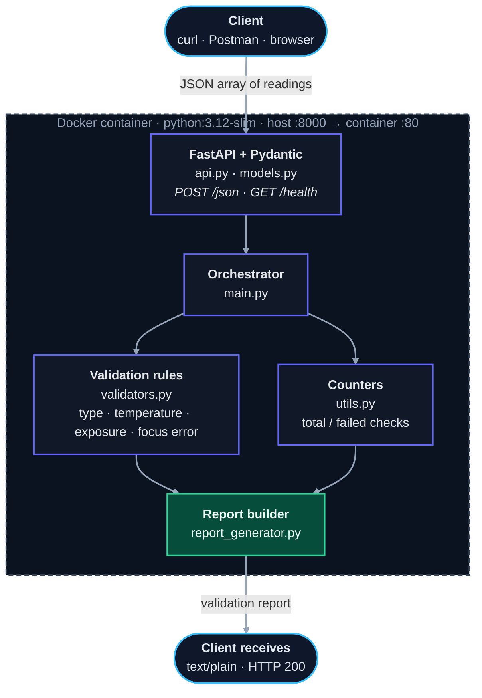
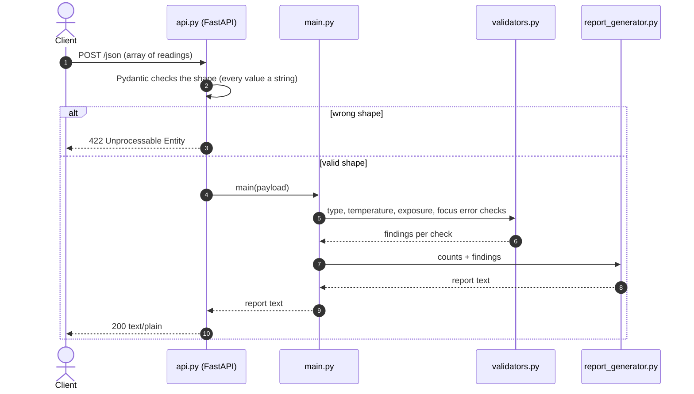
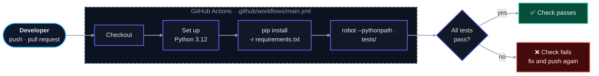

# 🔬 Sensor Data Validation Framework

[](https://github.com/agragab/automatic-validation-framework/actions/workflows/main.yml)


Send a batch of sensor readings as JSON to a small HTTP service and get back a **plain-text validation report**: which readings have the wrong type, which are out of range, and which are empty.

The service runs in Docker, is covered by a behaviour-style **Robot Framework** test suite, and is tested automatically by **GitHub Actions** on every push and pull request.

## 📖 About

This project is a hands-on exercise in building and testing a small data-validation service end to end:

- **A validation service** with a typed HTTP API (FastAPI + Pydantic) and rule-based checks on `temperature`, `exposure` and `focus_error`.
- **Readable, behaviour-driven tests** written in Robot Framework's Given / When / Then style, including edge cases at every range boundary.
- **Automation around it**: a container image that refuses to build if the tests fail, and a CI workflow that runs the same tests remotely.

Built by [@agragab](https://github.com/agragab).

## 🧭 How it works



### Request lifecycle



## 🚀 Quick start

### With Docker

```bash
git clone https://github.com/agragab/automatic-validation-framework
cd automatic-validation-framework
docker compose up --build
```

The image build runs the test suite first, so a failing test stops the build. The service is then available on `http://localhost:8000`, and FastAPI's interactive docs are at `http://localhost:8000/docs`.

### Without Docker

Requires Python 3.12 or newer.

```bash
python -m venv .venv
source .venv/bin/activate        # Windows: .venv\Scripts\activate
pip install -r requirements.txt
uvicorn api:app --reload --port 8000
```

### Send some readings

```bash
curl -X POST http://localhost:8000/json \
     -H "Content-Type: application/json" \
     -d @examples/payload.json
```

The request body is a **JSON array** of readings. `examples/payload.json` contains:

```json
[
  {"m_id": "101", "timestamp": "2026-10-09T08:00:00", "temperature": "25",  "exposure": "15", "focus_error": "3"},
  {"m_id": "102", "timestamp": "2026-10-09T08:05:00", "temperature": "19",  "exposure": "22", "focus_error": "12"},
  {"m_id": "103", "timestamp": "2026-10-09T08:10:00", "temperature": "A0a", "exposure": "",   "focus_error": "5"}
]
```

> **Every value must be a string**, including numbers (`"25"`, not `25`). A JSON number is rejected with `422` before any validation runs. A malformed string such as `"A0a"` is accepted and reported as a finding.

### Example response

```text
Report on JSON: 
--------------------------------------------------
Total tests: 30
Passed tests: 25
Failed tests: 5
--------------------------------------------------
    Incorrect Type:
    Sequence: 2
    Test: temperature
    Value: A0a
    Exception Type: ValueError

    Temperature Error:
    Sequence: 1  Reading: 19    WARNING: Temperature is too low

    Exposure Error:
    Sequence: 1  Reading: 22    WARNING: Subject is overexposed
    Sequence: 2  Reading: Null    Empty Value

    Focus Error:
    Sequence: 1  Reading: 12    WARNING: Focus Error is outside permitted range
```

(Blank lines condensed. `Sequence` is the **zero-based** position of the reading in your array.)

## 📏 Validation rules

| Field | Valid range | Reported when |
| --- | --- | --- |
| `temperature` | 20 – 50 | below 20 (too low), above 50 (too high), or empty |
| `exposure` | 10 – 20 | below 10 (underexposed), above 20 (overexposed), or empty |
| `focus_error` | 10 or below (no lower bound) | above 10, or empty |
| `m_id`, `temperature`, `exposure`, `focus_error` | integer string | the value cannot be converted to an integer (reported as `ValueError`) |

Range limits are inclusive. Empty values are reported as `Null` / `Empty Value`. A value that is not an integer is reported once under *Incorrect Type* and skipped by the range check. `timestamp` is not validated.

**Counting:** every reading counts as 10 checks, so `Total tests = 10 × number of readings`. `Failed tests` is the number of type errors plus range/empty findings.

## 🧪 Tests and CI

The suite has **16 Robot Framework test cases** written in Given / When / Then style, covering each field inside range, outside range, at the exact boundaries, empty, and with an invalid type.

```bash
pip install -r requirements.txt
robot --pythonpath . tests/
```

Robot writes `log.html`, `report.html` and `output.xml` to the current directory (all git-ignored). Open `report.html` for a readable summary.

GitHub Actions runs the same command on every push and pull request.



## 🗂️ Project layout

```text
.
├── api.py                  FastAPI app: GET /health, POST /json
├── models.py               TypedDict model of one reading
├── main.py                 Orchestration: run checks, count, build report
├── validators.py           Validation rules + Robot Framework keywords
├── utils.py                Total / failed check counters
├── report_generator.py     Builds the plain-text report
├── tests/
│   └── validation.robot    Robot Framework test suite (16 cases)
├── examples/
│   ├── payload.json        Small request used in this README
│   └── sample_readings.json  Larger, deliberately messy sample (22 readings)
├── Dockerfile              Image; runs the tests during build
├── compose.yaml            Port mapping 8000 → 80
└── .github/workflows/
    └── main.yml            CI: run the Robot suite on push and PR
```

## 🛣️ Known limitations and next steps

- Range limits are hard-coded in `validators.py`; they are not configurable per request.
- Duplicate `m_id` values are not detected.
- `Total tests` is a fixed 10 checks per reading, not a count of checks actually executed.
- Dependencies in `requirements.txt` are not version-pinned.
- Planned tooling: `ruff`, `mypy`, a coverage threshold in CI, and a `pyproject.toml`.
