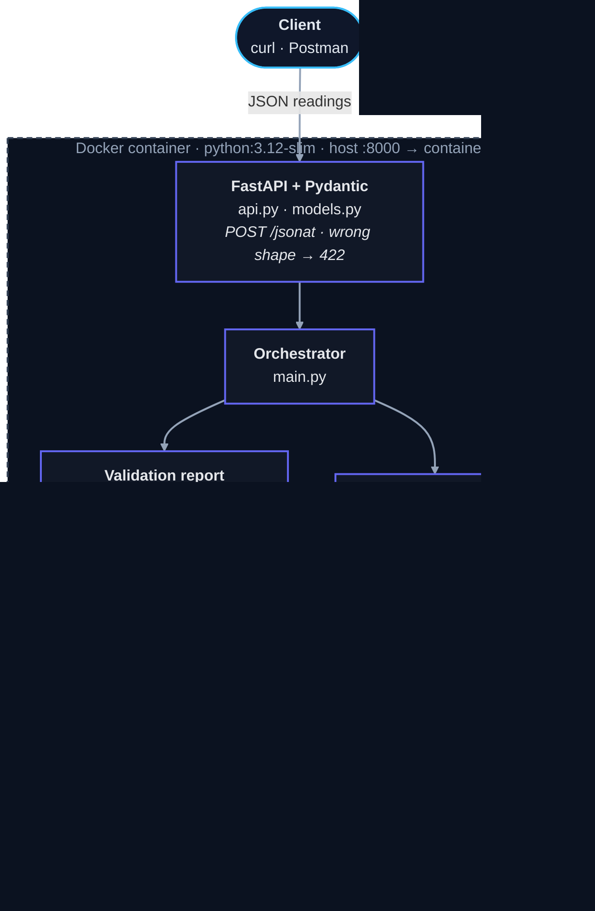
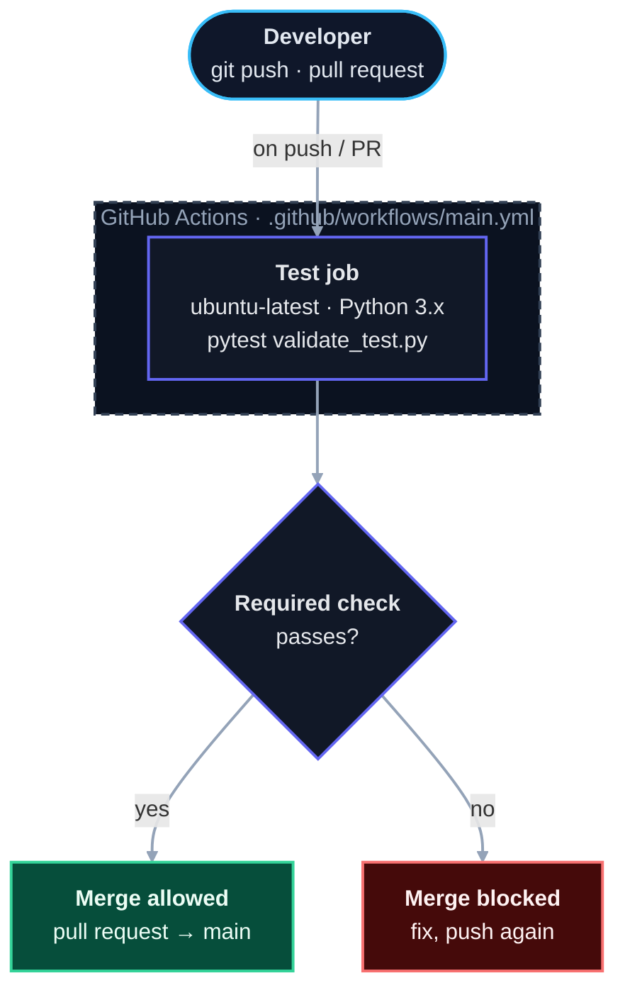

# Sensor Data Validation Framework

[](https://github.com/agragab/automatic-validation-framework/actions/workflows/main.yml)


Send a batch of sensor readings as JSON to a Dockerized HTTP service. One request comes back with **two things in a single plain-text response**: the **pytest results** of the project's own test suite, and a **validation report** for the readings you sent.

## How it works



1. The client posts JSON to `POST /jsonat`. Docker maps host port **8000** to the container's port **80**.
2. FastAPI validates the request shape with Pydantic. A body that does not match the model is rejected with `422` before any of the project's code runs.
3. `main.py` runs the value checks and builds the validation report, and runs pytest in a subprocess.
4. Both results are joined into one plain-text response.

## Quick start

Requires Docker.

```bash
git clone https://github.com/agragab/automatic-validation-framework
cd automatic-validation-framework
docker compose up --build
```

The service is now on `http://localhost:8000`. FastAPI's interactive docs are at `http://localhost:8000/docs`.

Send readings (save this as `payload.json`):

```json
{
  "list": [
    {"m_id": "101", "timestamp": "2026-10-09T08:00:00", "temperature": "20", "exposure": "2",   "focus_error": "0"},
    {"m_id": "102", "timestamp": "2026-10-09T08:05:00", "temperature": "19", "exposure": "A8a", "focus_error": "53"}
  ]
}
```

```bash
curl -X POST http://localhost:8000/jsonat \
     -H "Content-Type: application/json" \
     -d @payload.json
```

Every value is sent as a string, including numbers (`"20"`, not `20`). That is how the input model is defined: a JSON number is rejected with `422`, while a malformed string like `A8a` gets through and is reported as a finding in the validation report.

### Example response

The response contains both parts. The validation-report part for the payload above is (blank lines condensed):

```text
Report on JSON: 
--------------------------------------------------
Total tests: 16
Passed tests: 13
Failed tests: 3
--------------------------------------------------
    Incorrect Type:
    Sequence: 2
    Test: exposure
    Exception Type: ValueError

    Focus Error:
    Test: 102    Reading: 53

    Exposure Error:

    Temperature Error:
    Sequence: 2  Reading: 19    WARNING: Temperature is too low.
```

The pytest part is returned in the same response body:

```text
pytest Result: 
--------------------------------------------------
============================= test session starts ==============================
platform linux -- Python 3.12.15, pytest-9.1.1, pluggy-1.7.0 -- /usr/local/bin/python3.12
cachedir: .pytest_cache
rootdir: /app
plugins: anyio-4.15.1
collecting ... collected 7 items

validate_test.py::test_validate_temperature_within_bounds PASSED         [ 14%]
validate_test.py::test_validate_temperature_outside_bounds XFAIL         [ 28%]
validate_test.py::test_validate_exposure_within_bounds PASSED            [ 42%]
validate_test.py::test_validate_exposure_outside_bounds PASSED           [ 57%]
validate_test.py::test_validate_focus_within_bounds PASSED               [ 71%]
validate_test.py::test_validate_focus_outside_bounds PASSED              [ 85%]
validate_test.py::test_temp_wrong_type XFAIL                             [100%]

========================= 5 passed, 2 xfailed in 0.05s =========================
```

## Validation rules

| Field | Valid range | Reported when |
| --- | --- | --- |
| `temperature` | 20 – 60 | at or below 19 (too low), at or above 61 (too high), or empty |
| `exposure` | 2 – 5 | below 2 or above 5 |
| `focus_error` | 0 – 52 | above 52 |
| any numeric field | integer string | the value cannot be converted to an integer (reported as `ValueError`) |

Empty `exposure` and `focus_error` values are skipped. Timestamps are not range-checked.

## Project layout

| File | Role |
| --- | --- |
| `api.py` | FastAPI app and the `POST /jsonat` route |
| `models.py` | Pydantic request model |
| `main.py` | Orchestration: runs the checks, builds the report, runs pytest |
| `validate.py` | Type, temperature, exposure and focus checks |
| `report_generator.py` | Builds the plain-text validation report |
| `validate_test.py` | pytest suite |
| `Dockerfile`, `compose.yaml` | Container image and port mapping |
| `.github/workflows/main.yml` | CI: runs pytest on every push and pull request |

## Tests and CI

```bash
pip install -r requirements.txt
pytest validate_test.py
```

GitHub Actions runs the same suite on every push and pull request. A pull request can only be merged into `main` once the test job passes.



## Known limitations and next steps

- Duplicate measurement IDs are not yet reported in the HTTP response.
- The total test count in the report is calculated as a fixed number of checks per reading.
- Tooling gates are planned: `ruff`, `mypy`, a coverage threshold in CI, and a `pyproject.toml`.
- Some tests are marked `xfail` for features still being implemented.
